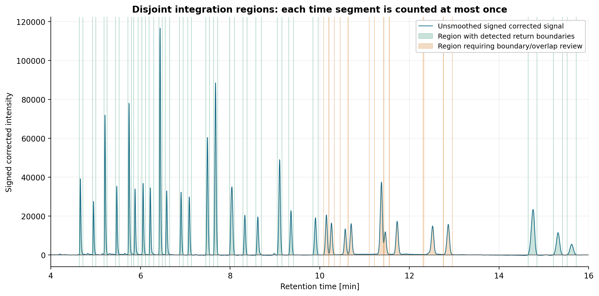

# Gas Chromatography Analysis

A step-by-step Python notebook for **LabSolutions gas chromatography exports**: validated parsing, visualization, baseline correction, peak detection, and signed numerical integration.

[Open the executed notebook](gas_chromatography.ipynb)



## Analysis workflow

1. Parse and validate the raw signal and the instrument's compound summary.
2. Plot the full chromatogram and the 4–16 minute detail.
3. Display a maximum-normalized trace, compound bars, and a compound heatmap.
4. Locate a dominant early-peak candidate and check sustained recovery before selecting the analysis region.
5. Select background candidates and fit a polynomial baseline with `np.polyfit` / `np.polyval`; asymmetric least squares is also available.
6. Subtract the estimated baseline from the **unsmoothed measurements**, preserving signed negative values.
7. Detect peak candidates on a separate Savitzky–Golay-smoothed copy.
8. Set integration boundaries within disjoint inter-peak valley partitions and flag uncertain regions.
9. Integrate the signed, unsmoothed corrected signal using the trapezoidal rule or Simpson's rule.
10. Export diagnostic figures, signal and peak tables, and a complete method summary.

The example contains **one measured sample**, labeled `231221_C37` by the instrument. Reference oils and mixtures are not supplied. Additional measured exports can be configured in `SAMPLE_FILES` for profile comparisons.

## Run the project

Use **Python 3.12**. From the project root:

```bash
python -m pip install -r requirements.txt
python scripts/run_notebook.py
```

The runner executes all **21 Python code cells** sequentially, captures printed output and Matplotlib figures in the notebook, and generates the result files. It uses headless Matplotlib and does not require a Jupyter server. It supports this notebook's plain Python and plotting workflow rather than arbitrary IPython magics or rich-display extensions.

For interactive use, open `gas_chromatography.ipynb` in your Jupyter interface, select an environment containing the required packages, and run every cell in order. Keep the kernel working directory at the project root so that `data/Gaschroma.txt` resolves correctly.

The tested direct dependency versions are pinned in `requirements.txt`; the notebook also records the execution environment in its metadata.

## Results and project files

| File | Contents |
| --- | --- |
| `gas_chromatography.ipynb` | 48 explained cells, including 21 code cells and 10 embedded figures |
| `data/Gaschroma.txt` | Supplied instrument export, preserved byte for byte |
| `results/Gaschroma_full.png`, `Gaschroma_zoom.png`, `Gaschroma_normalized_overlay.png`, `Gaschroma_compound_bars.png`, `Gaschroma_compound_heatmap.png` | Five original visualization views |
| `results/Gaschroma_preprocessing_*.png` | Five diagnostics: early peak, baseline, negative values, peak candidates, and integration |
| `results/Gaschroma_preprocessing_signal.csv` | All raw measurements, selection flags, baseline-fit flags, and derived signals |
| `results/Gaschroma_preprocessing_peak_candidates.csv` | Numbered maxima, prominence, and half-prominence widths |
| `results/Gaschroma_preprocessing_integration.csv` | Integration boundaries, signed areas, and overlap/boundary review flags |
| `results/Gaschroma_preprocessing_summary.json` | Parameters, decisions, polynomial coefficients and coordinate transform, diagnostics, and totals |
| `scripts/run_notebook.py` | Headless execution and output capture |
| `tests/` | Parser and numerical regression checks |

The signal CSV retains all 25,500 measurements. Derived values are blank outside the selected analysis region. Areas are exported in signal × minute and signal × second; the physical detector signal unit is not specified in the instrument export.

## Results for the supplied export

These values use the configured **cubic polynomial**, automatic background-point selection, and trapezoidal integration.

| Quantity | Result |
| --- | ---: |
| Raw signal points | 25,500 |
| First / last recorded time | 0.00017 / 16.99950 min |
| Instrument peak-table entries | 65 |
| Instrument compound-summary rows | 35 |
| Positive reported compound percentages | 31 |
| Sum of reported compound percentages | 100.000% |
| Early candidate apex | 1.70883 min |
| First analysis point | 2.63817 min |
| Analysis points | 21,543 |
| Selected background candidates | 3,385 |
| Selected-point baseline RMSE | 183.714 signal units |
| Signal candidates / disjoint integration regions | 32 |
| Peaks flagged for overlap / boundary review | 2 / 9 |
| Raw / signed corrected negative values | 3,070 / 7,191 |

Raw signal points, instrument-detected peaks, named compound rows, and newly detected candidates describe different objects. Their counts need not match. The analysis region extends to the last recorded point, independently of the 4–16 minute display window.

## Configuration and interpretation

The first code cell contains paths, display settings, sample files, and `PREPROCESSING_SETTINGS`. The early-peak return threshold and its quiet reference interval are operational choices that should be checked in the diagnostic. A dominant early peak is a candidate, not a chemical identification.

The default baseline is a degree-3 polynomial fitted to low-signal candidates within time bins. Manual intervals or observed-time anchors can replace automatic selection. Coefficients are stored in descending powers of centered, scaled time, with the transformation recorded in JSON. The selected-point RMSE measures fit to those candidates and does not validate the physical background. The baseline diagnostic exposes remaining deviations; some points lie outside the fitted-point span.

Only the detection and boundary-search copy is smoothed. Original and baseline-corrected measurement arrays retain signed negatives; neither absolute-value rectification nor zero clipping is applied. Filtered preprocessing requires nearly uniform time spacing and rejects irregular sampling instead of silently resampling.

Inter-peak minima cap neighboring integration regions, preventing repeated integration of a time interval. This partition does **not** deconvolve coeluting components. Elevated valleys and uncertain returns are flagged for review, and unresolved shoulders may never produce separate detected maxima. Candidate areas are uncalibrated signal areas, not concentrations or compound assignments.

The original compound bars and heatmap remain based on the instrument's `Conc. %` values. The optional `area_percent` mode uses the sum of areas in the **Compound Results** table; unassigned peaks outside that table are excluded. Neither metric is an oil mixing fraction. Combined labels such as `C18:1 cis/trans` remain intact, and missing entries remain distinct from explicit zeros.

## Verification

```bash
python -m unittest discover -s tests -v
```

All **24 tests pass**. Checks cover incomplete and invalid exports, duplicate files, missing-versus-zero values, signed negatives, a known quadratic baseline, manual background selection, irregular sampling, early-recovery decisions, the AsLS alternative, and exported raw data. Numerical fixtures check both integration methods, isolated Gaussian area error below 0.25%, and equality between summed overlapping-peak partitions and their union area. These checks validate implementation behavior, not calibration or component-specific areas in an overlap.

References: [Shimadzu — Analysis results of GC](https://www.shimadzu.eu/service-support/technical-support/analysis-basics/fundamentals/results.html), [NumPy polynomial fitting](https://numpy.org/doc/stable/reference/generated/numpy.polyfit.html), [SciPy peak detection](https://docs.scipy.org/doc/scipy/reference/generated/scipy.signal.find_peaks.html), and [SciPy trapezoidal integration](https://docs.scipy.org/doc/scipy/reference/generated/scipy.integrate.trapezoid.html).
