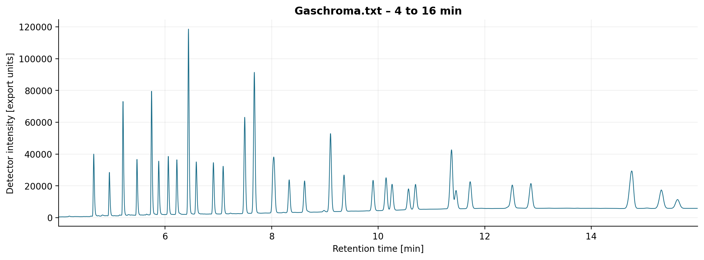

# Gas Chromatography Analysis

A step-by-step Python notebook for parsing a **LabSolutions gas chromatography export**, checking data integrity, and visualizing chromatograms and instrument-reported compound profiles.

[Open the executed notebook](gas_chromatography.ipynb)



## What the notebook shows

| View | Purpose | Interpretation |
| --- | --- | --- |
| Full chromatogram | Inspect the complete recorded run | Original detector intensities |
| Zoomed chromatogram | Resolve the smaller peaks from 4 to 16 minutes | Original intensities with a local display scale |
| Normalized trace / overlay | Compare signal shapes within a common window | Intensity divided by that window's maximum |
| Compound bars | Rank the largest reported compound percentages | Top 12 values, without renormalizing the subset |
| Compound heatmap | Inspect every compound positive in at least one sample | One shared scale; missing values remain distinct from zero |

The included file is **one real sample**, labeled `231221_C37` in its instrument metadata. Reference oils and mixtures are not supplied. The overlay and heatmap therefore show one sample until additional measured exports are configured.

## Quick start

Use **Python 3.12**. From the project root, install the pinned dependencies and execute the notebook:

```bash
python -m pip install -r requirements.txt
python scripts/run_notebook.py
```

The runner executes the notebook's plain Python cells in order, saves their printed output and figures into the notebook, and writes five PNG files to `results/`. It uses headless Matplotlib and does not need a running Jupyter server. It is specific to this notebook's Python and Matplotlib workflow, rather than a general Jupyter execution engine.

For interactive use, open `gas_chromatography.ipynb` in your Jupyter interface, select a Python environment containing NumPy and Matplotlib, and run from top to bottom. Keep the kernel's working directory at the project root.

## Project files

| Path | Contents |
| --- | --- |
| `gas_chromatography.ipynb` | Explained analysis, reusable functions, and saved results |
| `data/Gaschroma.txt` | Supplied instrument export, preserved byte for byte |
| `results/` | Five generated PNG figures |
| `requirements.txt` | Tested direct dependency versions |
| `scripts/run_notebook.py` | Reproducible headless execution |
| `tests/test_notebook.py` | Parser, normalization, and comparison regression checks |

## Data checks

| Measurement | Included export |
| --- | ---: |
| Signal points | 25,500 |
| First / last recorded time | 0.00017 / 16.99950 min |
| Nominal end time in metadata | 17 min |
| Signal points from 4 to 16 min | 18,000 |
| Detected peaks in the instrument peak table | 65 |
| Compound rows | 35 |
| Compounds with positive reported percentages | 31 |
| Sum of reported compound percentages | 100.000% |

Signal points, detected peaks, and compound rows describe different objects. The instrument's peak table includes unassigned peaks and multiple peaks assigned to the same compound. The notebook reads the compound summary directly; it does not reintegrate the raw signal or reconstruct concentrations from the peak table.

## Configuration

Edit the first code cell to change the input file, display window, output directory, or sample dictionary. Paths are relative to the project root. Additional exports must follow the same section and column format.

The bar chart and heatmap offer two distinct metrics:

- **`reported_percent`**: use the exported `Conc. %` values directly.
- **`area_percent`**: divide each named compound's area by the sum of areas in the **Compound Results** table. Unassigned peaks outside that table are excluded from this denominator.

The normalized overlay scales each trace by its maximum **inside the selected window**. Every sample must cover that complete window. Negative detector values are preserved, and no smoothing, baseline subtraction, or retention-time alignment is applied.

The parsers reject missing or duplicated sections, incomplete tables, invalid numbers, duplicate compound identifiers, and non-increasing retention times. Duplicate file paths and byte-identical copies cannot be labeled as independent samples.

## Scientific interpretation

Peak positions support comparison under compatible analytical conditions; matching retention times alone do not establish identity because compounds may coelute. Quantitative interpretation depends on calibration and detector response. Maximum-normalized intensity, uncorrected area share, instrument-reported compound percentage, and oil mixing fraction are different quantities.

Combined report labels such as `C18:1 cis/trans` are preserved. The export contains calibration coefficients, but this notebook does not validate the calibration, identify an oil, estimate mixture proportions, or infer chemical absence from a reported zero. The physical signal unit is not specified by the export.

Reference: [Shimadzu — Analysis results of GC](https://www.shimadzu.eu/service-support/technical-support/analysis-basics/fundamentals/results.html).

## Verification

```bash
python -m unittest discover -s tests -v
```

Publication checks cover the real export, malformed and incomplete data, normalization limits, missing-versus-zero values, duplicate sample files, and preservation of source arrays. All 11 code cells were executed sequentially with headless Matplotlib, and all five figures were regenerated from the supplied data. Recorded execution versions are included in the notebook metadata.
